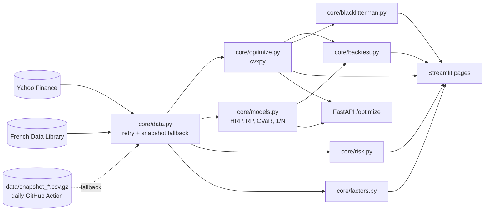

# 📈 AlphaFrontier


**An interactive, teaching-first portfolio-construction lab.** Live market data, honest walk-forward testing,
Black-Litterman, risk and stress tests, Fama-French factors, and a REST API, in plain language.
Started as MScFE 652 Group Work Project 1 (WorldQuant University) by Ajeet Kumar, Rajkumar S and Yijing Hong; rebuilt as an open-source app by Ajeet Kumar.

## Features
| Page | What it does |
|---|---|
| 🎓 **Learn & Quiz** | Interactive lessons (diversification, Sharpe, estimation noise), a risk-profile quiz that sets your default cap, a final quiz |
| 🎯 **Portfolio Optimizer** | Max-Sharpe / min-variance with and without a position cap, efficient frontiers, back-test, one-year scenarios, PDF summary |
| ⏱️ **Walk-forward back-test** | Rolling re-estimation, monthly/quarterly rebalancing, trading costs, six strategies vs 1/N and the S&P 500, bootstrap significance test |
| 🧭 **Black-Litterman** | Market-implied prior + your views with confidence → posterior returns → weights |
| 🛡️ **Risk & stress** | VaR/CVaR (historical & normal), drawdowns, risk contributions, COVID/2022/2025 replays, beta shock |
| ⚖️ **Model comparison** | Max Sharpe, min variance, risk parity, HRP, min CVaR, 1/N side by side + estimation-noise lab |
| 🔬 **Factor analysis** | Fama-French 5 factors, OLS (HAC) + Huber, chronological train/test; Nifty 50 market model for Indian stocks |
| 🎲 **Simulation vs optimization** | How many random portfolios match the exact optimum, with/without a cap |
| 📘 **Report & methodology** | The research report explained simply + limitations |

## Architecture


## Run locally
```bash
git clone https://github.com/ajeetk095/portfolio-lab.git && cd portfolio-lab
python -m venv .venv && source .venv/bin/activate      # Windows: .venv\Scripts\activate
pip install -r requirements.txt
streamlit run app.py
```
Offline? Tick **Demo mode** (synthetic data) to explore every page.

## REST API
```bash
pip install -r requirements-api.txt
uvicorn api.main:app --reload          # docs at http://localhost:8000/docs
curl -X POST localhost:8000/optimize -H 'content-type: application/json' \
  -d '{"tickers":["AAPL","XOM","WMT","BAC"],"model":"HRP","cap":0.4}'
```
`POST /optimize/from-moments` takes your own expected returns and covariance (no data needed).

## Docker
```bash
docker compose up --build     # app on :8501, API on :8000
```

## Develop
```bash
pip install -r requirements-dev.txt
pre-commit install            # ruff on every commit
pytest -q --cov=core --cov=api
```
57 tests: solver cross-checks against SciPy, no-look-ahead proof for the back-test, Black-Litterman identities, data fallback, API, and headless rendering of every page.

## Data
Yahoo Finance via `yfinance` · Kenneth R. French Data Library · committed daily snapshot as a fallback (see `data/README.md`).

> **Disclaimer.** Educational software, not investment advice. Historical estimates are noisy; past performance does not predict future results.

© 2026 Ajeet Kumar · MIT License · [Documentation](docs/DOCUMENTATION.md) · [Deployment](docs/DEPLOYMENT.md) · [Report review](docs/REPORT_REVIEW.md)
